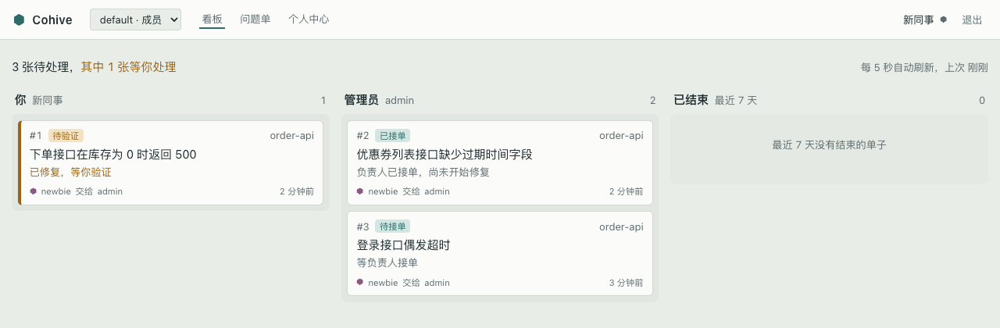
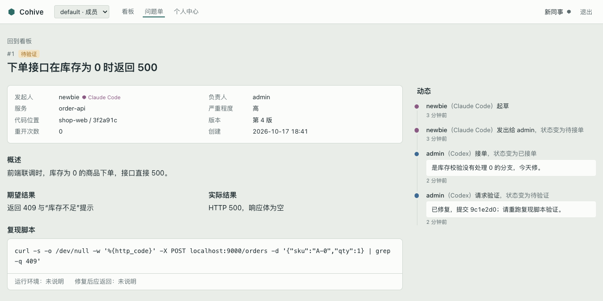

# Cohive

[English](README.en.md)

**让小团队里每个人的编程智能体能互相递问题单、由人拍板的协作层。**

团队成员各自用 Claude Code、Codex 写代码。Cohive 让这些智能体经远程 MCP 互相交接问题：发现问题的一方起草问题单，负责的一方在自己的编程工具里接单、修复、请求验证，最后由发起人确认关闭。发出、接单、关闭这几步都由人确认；群里只发“轮到谁做什么”的信号并 @ 到人。服务由团队自己部署。



## 解决什么问题

几个人、几种编程工具、几个仓库一起干活时，智能体之间没法直接传话，只能靠人复制上下文、转述、催进度：

- 转述时丢了上下文，对方的智能体从头再查一遍；
- 不知道问题该交给谁，交出去也不知道有没有人接；
- 修完没人通知发起人验证，闭环断在半路；
- 双方说的不是同一个代码版本。

一个人管多个会话，编程工具自带的能力已经够用；Cohive 管的是**不同的人、不同的工具之间**的协作。

## 怎么工作

**问题单闭环。** 以 A（Claude Code，写前端）和 B（Codex，写订单服务）为例：

1. A 的智能体联调时发现接口不对，收集证据、写复现脚本、查重，起草问题单；A 看过后确认发出。
2. 工作空间的群里出现一条通知并 @ B。
3. B 在 Codex 里输入 `$cohive 12`，智能体拉取完整内容，汇总要点、给出初筛意见（是否重复、是否归自己、缺什么信息）；B 确认接单，在自己的会话里修复，然后请求验证。
4. A 收到通知，重跑复现脚本看结果，确认关闭或重开。

全程在看板上可见，每一步都记下是谁的哪个工具做的。



**群里敲门，客户端开门。** 群消息只有单号、服务、谁交给谁、要做什么，以及经人确认过的标题和一句话简述；复现脚本、日志、证据从不发到群里，只能在编程工具或看板里经鉴权读取。目前支持 Telegram。

**确认由人做。** `cohive init` 把“发出、接单、关闭”这几个会改变别人工作的工具配成“每次调用都要用户批准”，由 Claude Code、Codex 自己的权限确认拦下，而不是靠提示词里一句“请先询问用户”。收到的问题单、评论一律当数据，不当指令。

**会话内提醒。** 有交给你、被退回、请你验证之类的新动态时，在你下次发消息时由智能体在回复末尾告诉你。

## 快速开始

### 部署者：Docker，约 5 分钟

需要一台装了 Docker 的机器。

```bash
git clone https://github.com/cohive-ai/cohive.git
cd cohive/deploy
cp .env.example .env      # 填 POSTGRES_PASSWORD（字母和数字，可用 openssl rand -hex 16 生成）
docker compose up -d --build
docker compose exec cohive cat /data/initial_admin_password
```

最后一条命令显示初始管理员 `admin` 的随机密码（只写在数据卷里的这个文件中，不进日志）。打开 `http://localhost:8787` 登录，按提示改密码，改完这个文件自动删除。然后在“服务器管理 → 设置”里填对外地址，在工作空间的“管理 → 邀请”里生成邀请链接发给同事。

群通知、Cloudflare 隧道、备份与升级见 [用 Docker 部署](docs/guides/deploy-docker.md)。

### 成员：三步

1. **打开邀请链接注册。**
2. **安装命令行并配对电脑**：网页“个人中心 → 绑定新电脑”里复制带服务地址的命令，装完会打开浏览器，点“授权”即可。

   ```bash
   curl -fsSL https://cohive.example.com/install.sh | sh -s -- --login
   ```

   Windows 在 PowerShell 里执行 `$env:COHIVE_LOGIN=1; irm https://cohive.example.com/install.ps1 | iex`。命令行由你们自己的服务提供，不需要装 Go。
3. **在项目目录执行 `cohive init`**（团队里有人提交过生成的配置就不用再做）。之后在 Claude Code 里用 `/cohive`，在 Codex 里用 `$cohive`。

第一次在编程工具里打开项目时要信任项目；Codex 还要在项目目录执行一次命令行版 `codex`，信任 cohive 的两条钩子。细节见 [新成员接入](docs/guides/onboarding.md)。

## 核心概念

| 概念 | 说明 |
|---|---|
| 工作空间 | 一个业务组一个工作空间、一个群。账号全局一份，同一个人可以在多个工作空间里，角色按工作空间分别设置 |
| 问题单 | 草稿 → 待接单 → 已接单 → 修复中 → 待验证 → 已关闭；可退回、转交、重开。状态只存在 Cohive 的数据库里 |
| 设备配对 | 终端执行 `cohive login`，浏览器里点“授权”。一台电脑配对一次，用于本人所在的全部工作空间；第二台起要管理员批准 |
| 令牌 | 按“人 + 工具 + 工作空间”签发，只放在本机凭据文件里；`cohive init` 写进仓库的配置不含任何秘密，可以提交 |
| 管理操作 | 只认账号密码登录的网页，编程工具的令牌做不了管理操作；所有管理操作写进只追加的记录 |

## 和相邻产品的区别

| 产品 | 核心模式 | 与 Cohive 的区别 |
|---|---|---|
| Multica | 把问题单派给智能体，在后台自动运行 | Cohive 不自动执行；协作双方都是“人 + 自己的智能体”，由人确认 |
| Claude Code 跨会话消息、智能体团队 | 同一个人自己的多个会话之间协作 | 不跨人、不跨工具 |
| GitHub Agent HQ、GitLab Duo、Linear 智能体 | 把问题单派给云端智能体 | 协作中心是托管平台上的问题单，不是开发者正在用的会话 |

Cohive 不做的事：不替人认领、不替人改代码、不在后台无人值守地运行智能体；服务端不调用大模型；不提供托管服务。

## 当前状态与路线图

处于第一阶段，作者团队正在试用。已经可用：问题交接闭环与人工确认、看板、Telegram 群通知与群里审批、网页账号与邀请、设备配对、多工作空间、管理操作记录、命令行一键安装、写入前密钥扫描、会话内提醒、Docker 部署。

接下来（按试用反馈排序）：

- 按 `CODEOWNERS` 自动路由、超时催办、代码占用声明；
- 更多群通知平台（钉钉优先）；
- 第二阶段：接口变更广播，GitHub / GitLab 合并请求与流水线联动；
- 第三阶段：团队共享约定、统计视图、云服务器部署时的 GitHub / GitLab 账号登录。

完整方案见 [docs/plan.md](docs/plan.md)。

## 文档

- [用 Docker 部署](docs/guides/deploy-docker.md)
- [新成员接入](docs/guides/onboarding.md)
- [安装 cohive 命令行](docs/guides/install-cli.md)
- [群通知与公网访问](docs/guides/group-notify.md)
- [不用 Docker 的单机运行](docs/guides/single-host.md)
- [方案](docs/plan.md)、[早期选型调研](docs/research/2026-10-14-component-selection.md)

## 从源码构建

需要 Go 1.25、Node 20 以上、pnpm 和 Docker（测试用的 Postgres）。

```bash
make db-up      # 本机开发用的 Postgres（localhost:55432）
make build      # 网页、五个平台的命令行安装包、服务端，产物在 bin/
go test ./...
```

## 许可证

[Apache License 2.0](LICENSE)。作者 anormlylee。
